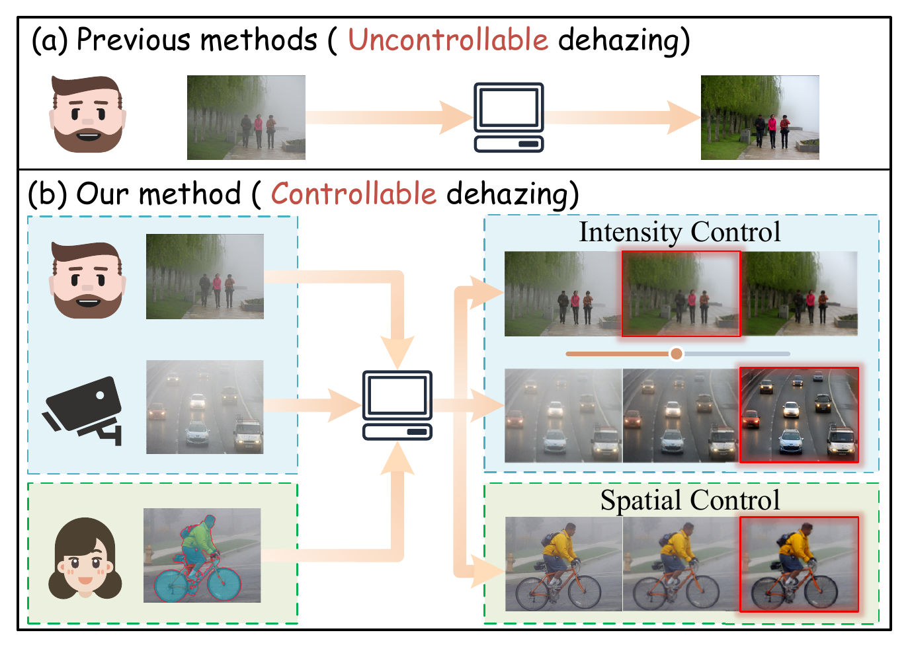
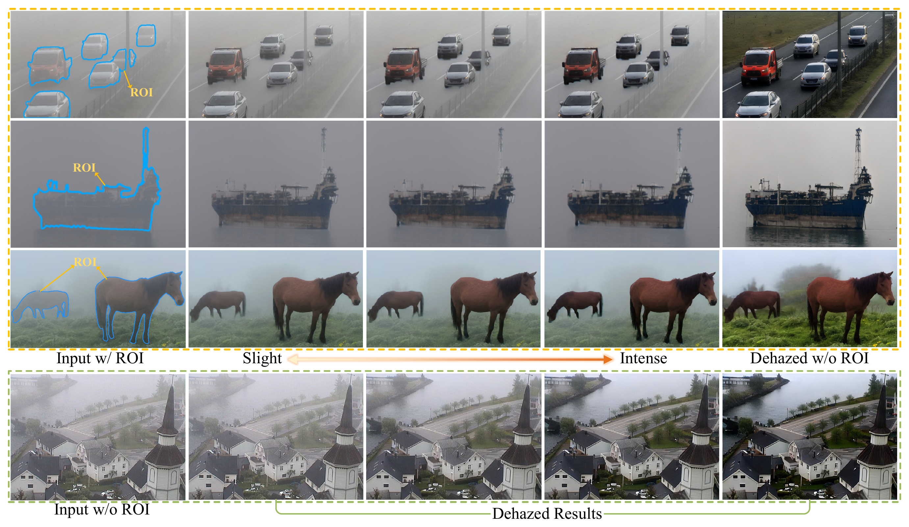
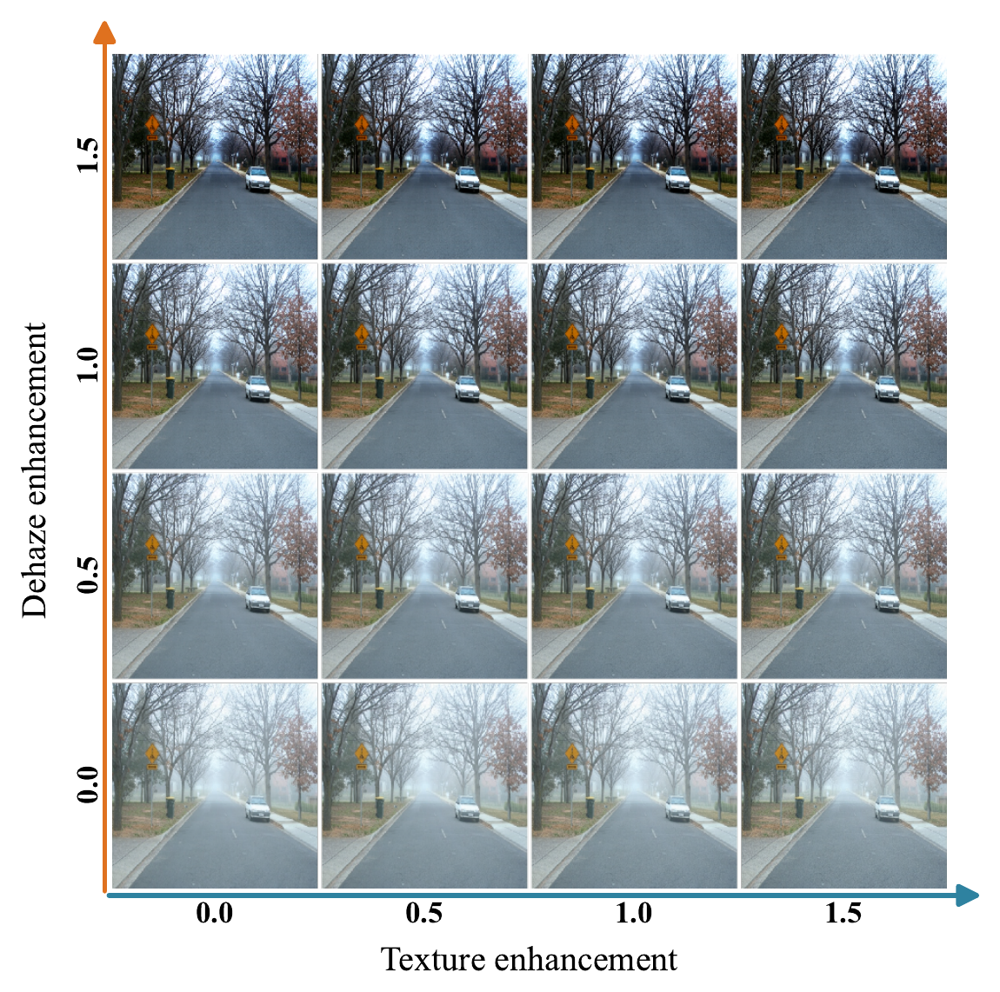

# Dehaze as You Desire

**DYD-Dehazing** is a one-step diffusion framework for controllable image dehazing. A single model supports different restoration preferences at inference time:

- adjust the dehazing intensity;
- adjust the amount of texture enhancement;
- select the spatial region to be processed.

The same checkpoint can produce a family of outputs without retraining.







## Setup

Python 3.10 and an NVIDIA GPU with CUDA are required.

```bash
pip install torch==2.1.1 torchvision==0.16.1 --index-url https://download.pytorch.org/whl/cu121
pip install -r requirements.txt
```

Prepare the pretrained model resources and training data, and set their paths in `configs/train_dehazing.json`. Datasets and model weights are not included.

## Training

Run commands from the repository root.

**1. Train the dehazing model** — `scripts/train_dehazing.py`

```bash
python scripts/train_dehazing.py --config configs/train_dehazing.json
```

The supplied configuration continues from step 3,000 to step 5,000. Set `resume_checkpoint` to the matching initialization checkpoint; the initial 3,000-step training procedure is not included.

**2. Train the detail branch** — `scripts/train_gdcm.py`

```bash
python scripts/train_gdcm.py --config configs/train_gdcm.json
```

Set `base_checkpoint`, `base_step`, and `base_sha256` in the configuration to your trained dehazing checkpoint.

## Inference

**Entry point:** `scripts/infer_dehazing.py`

```bash
python scripts/infer_dehazing.py \
  --checkpoint outputs/gdcm/checkpoints/gdcm-002000 \
  --input path/to/hazy-image-or-folder \
  --output path/to/results \
  --alpha 1.0 --beta 1.0
```

`--alpha` controls dehazing intensity and `--beta` controls texture enhancement. For a single image, add `--mask path/to/mask.png` to select the processing region. Outputs retain the input dimensions.

## Related work

The training guidance follows adversarial score distillation (ASD), as developed for stable one-step diffusion restoration:

> Wei Zhu, Kai Zhang, Yu Zheng, Lei Luo, and Jian Yang. *Adversarial Score Distillation for Stable One-Step Diffusion in Real-World Image Super-Resolution*. ECCV 2026. [Paper](https://doi.org/10.1007/978-3-032-37196-6_20)
